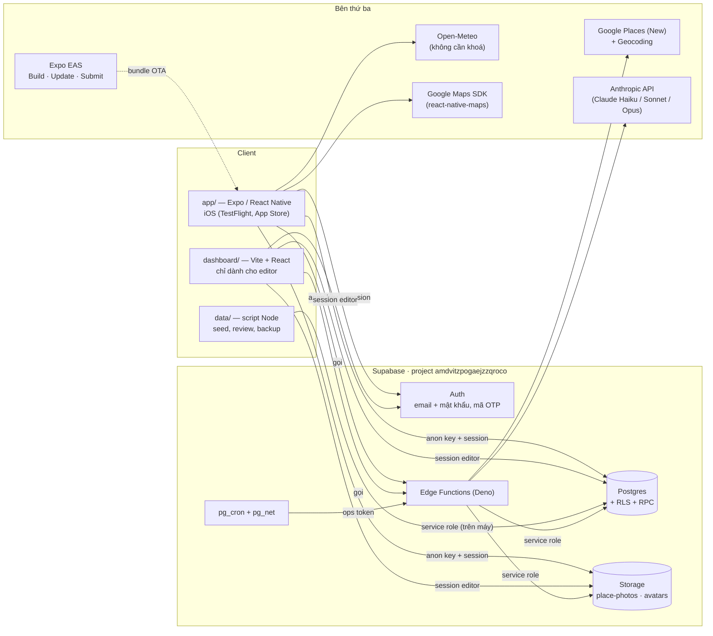
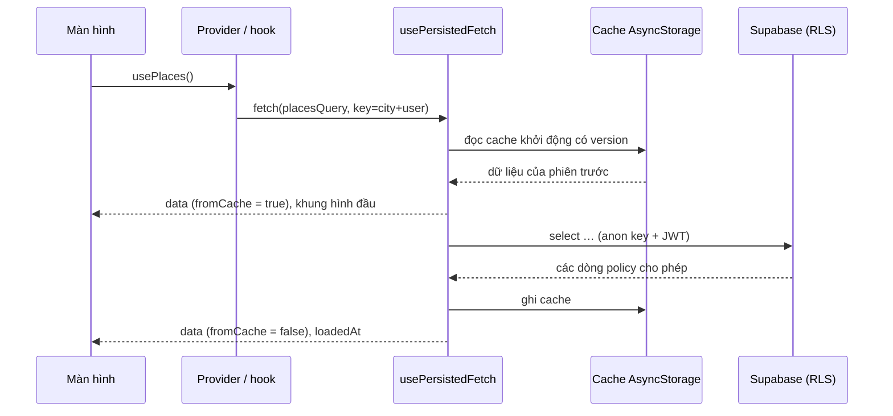
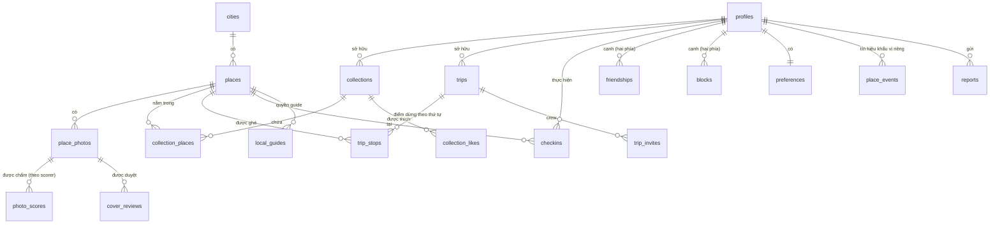
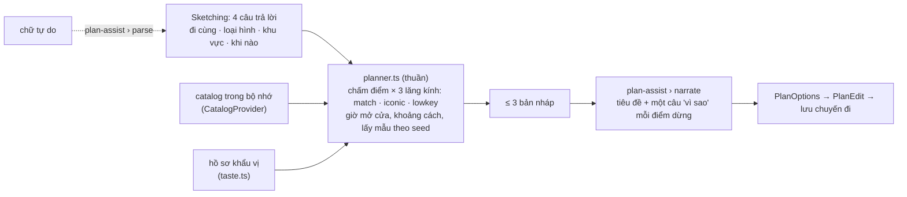
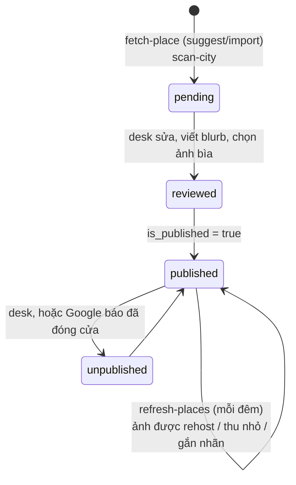
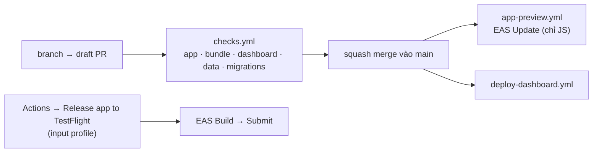

# City Crew — thiết kế hệ thống

Toàn bộ hệ thống trên một trang: có những phần nào, mỗi phần giữ cái gì, và
một yêu cầu đi giữa chúng ra sao. Đây là bản đồ vẽ từ mã nguồn ngày
30/10/2026. Lý do của từng quyết định nằm ở comment đầu file làm ra quyết
định đó; trang này chỉ gọi tên các file ấy chứ không chép lại. Luật giữa
các tầng của app, và cái gì trong CI đỏ lên khi luật bị phá, nằm ở
[`architecture.md`](architecture.md). Đọc trang đó trước khi chuyển code.

## 1. Sản phẩm là gì

Một cẩm nang thành phố cho Việt Nam (TP.HCM, Hà Nội, Đà Nẵng, Đà Lạt, Huế
và các nơi khác, mỗi nơi một dòng trong `cities`) bằng năm ngôn ngữ: tiếng
Anh, tiếng Việt, tiếng Nhật, tiếng Trung giản thể và phồn thể. Người đọc:

- **khám phá** catalog địa điểm đã được tuyển chọn của một thành phố (danh
  sách và bản đồ, bộ lọc, tìm kiếm trên mọi ngôn ngữ cùng lúc);
- **lưu** địa điểm vào bộ sưu tập, và có thể công khai chúng;
- **lên kế hoạch** cho một ngày: bốn câu trả lời (đi với ai, loại gì, ở
  đâu, khi nào) thành tối đa ba lịch trình nháp, có thể sửa, lưu thành
  chuyến đi và chia sẻ với crew;
- **check-in**, kết bạn, xem bạn bè đã lưu gì, và nhận nhắc nhở trước
  chuyến đi.

Phía sau người đọc có một desk biên tập (dashboard) tuyển chọn catalog, và
một nhóm job phía server giữ dữ liệu Google luôn mới và ảnh luôn nhẹ.

## 2. Hình thái

**Không có app server.** App điện thoại và desk đều nói thẳng với Supabase
bằng khoá công khai và session của chính người dùng. **Row-Level Security
của Postgres là tầng phân quyền.** Edge Function chỉ tồn tại ở chỗ cần một
bí mật: khoá Google, khoá Anthropic, hoặc service role.



| phần | ở đâu | runtime | deploy bởi |
|---|---|---|---|
| App di động | `app/` | Expo SDK 58, React Native 0.88, React 19, TypeScript | EAS Update mỗi lần merge chạm `app/` (`app-preview.yml`); binary thì chạy tay (`app-release.yml`) |
| Desk | `dashboard/` | Vite, React, React Router | `deploy-dashboard.yml` khi push lên `main` |
| Database | `supabase/migrations/` (113 file) | Postgres + RLS | **apply tay.** CI chỉ test |
| Edge Functions | `supabase/functions/` | Deno | deploy tay |
| Công cụ dữ liệu | `data/` | Node | chạy trên máy |

## 3. App di động

### 3.1 Các tầng

```
screens/        một màn một file (23 màn + phần con ở explore/, profile/)
   ↓
components/     UI dùng lại; components/ui/ là design system
   ↓
lib/*.tsx       provider: trạng thái dùng chung trong React context
   ↓
lib/data/       mọi câu hỏi tới Postgres / Storage, mỗi aggregate một file
lib/*.ts        nghiệp vụ thuần: không React, không mạng, chạy được trong Node
```

Mũi tên chỉ đi xuống. Không màn hình hay component nào import Supabase.
`no-restricted-imports` của ESLint canh điều này, và sàn coverage từng file
(100 % cho `lib/*.ts`) giữ tầng thuần luôn thuần. Bảng đầy đủ ở
[`architecture.md`](architecture.md).

### 3.2 Provider: trạng thái dùng chung

`App.tsx` lồng provider theo thứ tự phụ thuộc. Cái bên trong đọc những cái
bên ngoài:

```
ThemeProvider › AppBoundary › Auth › I18n › City › Catalog › Crew
  › Invitations › MyTrips › Checkins › Save › TabBarDuck
```

| provider | giữ cái gì | ghi chú |
|---|---|---|
| `auth.tsx` | session, hồ sơ, đăng nhập/đăng ký/đăng xuất, xoá tài khoản | `userId` lấy từ cache trên máy trong vài ms, trước khi `session` được xác nhận, nên truy vấn theo người đọc không phải chờ một vòng mạng |
| `city.tsx` | thành phố hiện tại | không bao giờ vẽ một thành phố rồi đổi sang thành phố khác. Thứ tự: chọn tay › vị trí đã cache (có giới hạn thời gian) › thành phố tự động đã lưu › TP.HCM |
| `i18n.tsx` | ngôn ngữ giao diện, `t()` | thứ tự dự phòng ở `lang.ts`. Phồn thể được sinh từ giản thể (`scripts/hant.ts`) |
| `catalog.tsx` | địa điểm công khai và bộ sưu tập biên tập của thành phố, lượt thích | một bản cho cả app. Trước đây năm màn tự fetch riêng |
| `save.tsx` | bộ sưu tập riêng của người đọc, trạng thái của các sheet lưu | bản thân các sheet do `components/SaveSheets.tsx` vẽ |
| `crew.tsx`, `invitations.tsx`, `mytrips.tsx`, `checkins.tsx` | bạn bè, lời mời chuyến đi, chuyến đi của mình, check-in | |
| đồng bộ tác dụng phụ | `ReminderSync`, `GuideGrantSync`, `SessionNavSync`, `ThemeAccountSync` | không vẽ gì; giữ hệ điều hành hoặc tài khoản khớp với app |

Ở chỗ nhiều người đọc một provider mà mỗi người chỉ đọc một phần, context
được chia theo đúng đường đó (`useSession` / `useProfile` /
`useAuthActions`, `useMyLists` / `useSaveActions`, …). Nhờ vậy một phần đổi
không làm người đọc phần khác vẽ lại. Test đếm số lần vẽ canh điều này.

### 3.3 Đọc, ghi và cache



- **Đọc**: một hàm async thuần trong `lib/data/<aggregate>.ts` →
  `lib/data/fetch.ts › usePersistedFetch` (cache trên máy có version,
  stale-while-revalidate, `loaded` / `loadedAt` / `fromCache`) → hook trong
  `lib/data/hooks.ts` → provider hoặc màn hình. `lib/stale.ts` quyết định
  khi nào hỏi lại.
- **Ghi** đi thẳng vào bảng dưới RLS và **ném lỗi khi bị từ chối**, để màn
  hình không bao giờ vẽ một thành công không có thật. Cập nhật lạc quan
  được đối chiếu lại sau (`likes.ts`, và `pendingSaves.ts`, vẽ một lượt lưu
  trước khi database xác nhận). `quota.ts` dịch lời từ chối vì giới hạn
  trong ngày thành câu chữ.
- **Quyền** không bao giờ được quyết định ở client. Chỗ nào app lặp lại một
  luật (`guide.ts`, `report.ts`) thì chỉ để khỏi đưa ra một nút mà database
  sẽ từ chối.

### 3.4 Điều hướng

Có năm tab: **Ideas, Explore, Trips, Collections, Profile**. Mỗi tab có
native stack riêng, và màn chi tiết được khai báo ở nhiều stack có chủ ý.
Màn nào cũng được bọc trong một `ScreenBoundary`, với `AppBoundary` là lớp
cuối. Route có kiểu nằm ở `src/nav.ts`.

### 3.5 Tính năng trên máy

| tính năng | cách làm | file |
|---|---|---|
| Bản đồ | `react-native-maps` với provider Google, gom cụm ghim | `components/PlacesMap.tsx`, `lib/cluster.ts` |
| Vị trí | `expo-location`, chỉ dùng để chọn thành phố gần nhất và ưu tiên kết quả tìm kiếm. Không bao giờ gửi cho API thời tiết | `lib/city.tsx`, `lib/citypick.ts` |
| Thời tiết | Open-Meteo, không cần khoá, hỏi bằng tâm của *thành phố* | `lib/weather.ts`, `lib/sky.tsx` |
| Nhắc chuyến đi | thông báo **cục bộ** (tối hôm trước và trong ngày), không có push server | `lib/reminders.ts`, `lib/remind.ts` |
| Chất lượng ảnh | module Expo native `modules/photo-score` (iOS, Apple Vision): điểm thẩm mỹ và các số đo, diễn đạt thành lời ở `photoScoreVision.ts` | `lib/photoScore*.ts` |
| Xuất dữ liệu | file JSON qua share sheet (không dùng signed URL, vì chính sách quyền riêng tư) | `lib/takeout.tsx`, `lib/export.ts` |
| Công tắc từ xa | bảng `app_flags` đọc lúc mở app, tới được cả binary App Store mà OTA không tới được | `lib/flags.ts` |
| Theme | 20 bảng màu, đồng bộ theo tài khoản | `src/palettes.ts`, `lib/theme.tsx` |

## 4. Nghiệp vụ lõi

### 4.1 Mô hình dữ liệu



| nhóm | bảng | ghi chú |
|---|---|---|
| Catalog | `cities`, `places`, `place_photos`, `category_terms`, `editorial_collection_origin` | `places` mang tên, blurb và khu vực theo từng ngôn ngữ (cộng một JSON `i18n` cho các ngôn ngữ mới hơn), các trường lấy từ Google (giờ mở cửa, đánh giá, giá), và `review_status` / `is_published` cho cổng duyệt của desk |
| Chấm ảnh | `photo_scores` (mỗi ảnh mỗi scorer một dòng, ví dụ Vision, `claude-labels`), `cover_reviews` | xem `docs/photo-labels.md`, `docs/photo-critic.md` |
| Con người | `profiles`, `preferences`, `friendships`, `blocks`, `reserved_handles`, `local_guides`, `editors` | `profiles` là 1:1 với `auth.users`. Mọi bảng cá nhân xoá theo dây chuyền khi xoá tài khoản |
| Lưu | `collections`, `collection_places`, `collection_likes`, `suggestion_dismissals` | bộ sưu tập là riêng tư hoặc công khai. Bộ sưu tập biên tập thuộc về tài khoản biên tập |
| Lên kế hoạch | `trips`, `trip_stops`, `trip_invites` | một chuyến đi có thành phố, ngày, buổi, người đi cùng và loại hình |
| Hoạt động | `checkins`, `place_events` | `place_events` chỉ nuôi hồ sơ khẩu vị |
| An toàn | `reports`, `moderation_log` | giới hạn trong ngày và lệnh cấm tự báo cáo mình được thực thi trong policy |
| Vận hành | `app_flags`, `ops_tokens`, `startup_traces`, `deck_traces` | trace chỉ được ghi bởi các channel có chẩn đoán (§7) |

RPC (hàm `security definer`) làm những gì một policy thường không làm
được: đếm trên dòng của người khác (`collection_like_counts`,
`trip_crew_counts`, `mutual_saves_counts`), truy vấn đồ thị xã hội
(`friend_suggestions`, `suggested_friends`, `block_user`), kiểm duyệt
(`moderate_collection`, `moderate_profile`, `reports_queue`), hạn mức
(`own_place_photos_today`, `my_reports_today`) và quyền của guide
(`guide_set_cover`, `guide_set_hidden`). Policy hỏi `auth.uid()` và
`is_editor()` một lần mỗi truy vấn, viết dạng `(select …)`. Một test trong
`supabase/tests/` canh điều này.

### 4.2 Bộ lên kế hoạch



Chọn địa điểm là **phép tính trên điện thoại**, nên người đọc không có sóng
vẫn có kế hoạch. `planner.ts` chấm điểm catalog dưới ba bộ trọng số. Nó tôn
trọng giờ mở cửa theo đồng hồ của thành phố (`clock.ts`,
`format.ts › openState`), xếp điểm dừng theo khoảng cách (`travel.ts`,
`geo.ts`) và lấy mẫu giữa các lựa chọn gần ngang nhau bằng một `seed` tường
minh, để nút Tạo lại có ý nghĩa mà hàm vẫn thuần. `gaps.ts` trả ít bản nháp
hơn khi catalog không đủ để trung thực đưa ra ba. Chỉ *câu chữ* đến từ một
model: `plan-assist` dùng Claude Haiku để đặt tên kế hoạch và viết một lý
do cho mỗi điểm dừng, và có thể tách một yêu cầu gõ tay thành bốn câu trả
lời.

### 4.3 Tìm kiếm, khẩu vị và xếp hạng

- `search.ts` và `searchIndex.tsx` tìm trên một haystack gộp mọi ngôn ngữ,
  bỏ dấu khi so ("banh mi" tìm ra "Bánh mì"), cùng các từ đồng nghĩa desk
  nhập trong `category_terms`.
- `taste.ts` và `tasteProfile.tsx` biến bốn tín hiệu (sở thích, bộ sưu tập
  đã lưu, địa điểm tự đề xuất, `place_events`) thành một mức ưa thích có
  giới hạn. Bộ lên kế hoạch đọc nó qua interface `Taste`.
- `rank.ts`, `popular.ts` và `exploreView.ts` sắp thứ tự Explore.

## 5. Phía server

### 5.1 Edge Functions

| function | ai gọi | ai được gọi | làm gì |
|---|---|---|---|
| `fetch-place` | app (thêm / đề xuất địa điểm), desk | người đã đăng nhập. `import` chỉ cho editor | tìm trên Google Places, geocode ngược, import thành địa điểm đang chờ, chưa công khai. Có hạn mức trong ngày (`fetch_place_allowance`) |
| `plan-assist` | app | người đã đăng nhập | Claude Haiku: `narrate` một bản nháp, `parse` chữ tự do |
| `delete-account` | app | chính chủ tài khoản | xoá user trong auth, dây chuyền xoá phần còn lại. Đóng góp vào catalog được đặt null, không bị xoá |
| `scan-city` | desk | editor | mỗi loại hình một truy vấn Places đã tuyển, import ở trạng thái chờ |
| `suspend-user` | desk | editor | cấm ở tầng auth (cần service role) |
| `write-blurb` | desk | editor | Claude Haiku viết nháp blurb theo từng ngôn ngữ và **không ghi gì**: nút Lưu của desk là cổng |
| `label-photos`, `rate-photos` | desk, ops token | editor / token | Claude vision: loại ảnh và tiêu chí ảnh bìa, độ đẹp trong cùng loại. `label-photos` ghi vào `photo_scores` dưới tên `claude-labels` |
| `refresh-places` | `pg_cron` mỗi đêm | ops token | hỏi lại Google về những địa điểm cũ nhất (`_shared/refresh-place.ts`) |
| `shrink-photos` | `pg_cron` mỗi giờ | ops token | thu ảnh trong Storage về đúng cỡ app vẽ |
| `rehost-photos`, `refresh-photos`, `prune-photos` | chạy tay | editor / token | chép ảnh Google vào Storage, thay `photo_ref` đã bị thu hồi, xoá file mồ côi |

`_shared/` giữ logic mà nhiều function cùng cần (`import-place.ts`,
`rehost.ts`, `classify.ts`, `gate.ts`, `place-name.ts`, …). Test của nó
chạy từ `app/src/lib/*.fn.test.ts`, dưới sàn coverage của Edge Function.

### 5.2 Việc định kỳ

`pg_cron` + `pg_net` gọi function với token trong `ops_tokens`. Lịch nằm ở
`supabase/functions/<job>/cron.sql` và được **apply tay**, không phải
migration: nó mint một bí mật lúc chạy, và database test migration không có
`pg_cron`.

### 5.3 Vòng đời của một địa điểm



Địa điểm do người đọc đề xuất chỉ người đó và desk nhìn thấy cho tới khi
một editor công khai nó. `isLive` (`lib/live.ts`) là định nghĩa duy nhất
của "hiện cái này cho người đọc".

## 6. Desk (`dashboard/`)

Cùng mô hình với app. `api.js` nói với Supabase bằng session của editor, và
RLS (`is_editor()`) quyết định được ghi gì. Route nằm ở
`dashboard/src/routes.jsx`:

- **Địa điểm**: danh sách, trình sửa (các trường, blurb theo ngôn ngữ, ảnh,
  ảnh bìa), thêm mới, quét một thành phố.
- **Thành phố**: ảnh hero và lời giới thiệu. **Từ tìm kiếm**: từ đồng nghĩa.
- **Báo cáo**: hàng đợi kiểm duyệt → gỡ công khai, xoá một trường, đình chỉ.
- **Ảnh bìa / các vòng đo ảnh**: duyệt ảnh bìa và các vòng đo cho nhãn ảnh
  và điểm ảnh.
- **Phân tích**: người đóng góp, độ phủ theo loại hình.

`data/` giữ phần ngoại tuyến: JSON seed, `places.review.json`, script backup
và snapshot, và các pipeline khởi tạo đã đóng băng (`fetch-places.mjs`,
`upsert-supabase.mjs`). Chúng được giữ để truy nguồn gốc, và không còn là
đường địa điểm đi vào nữa.

## 7. Channel phát hành và chẩn đoán



Build profile đóng một channel vào mỗi binary (`eas.json`), và
`lib/channel.ts` đọc lại nó:

| channel | chẩn đoán |
|---|---|
| `development` | bật, nhưng số đo thời gian bị `__DEV__` làm lệch |
| `preview` | **bật**: `startup_traces` (thác khởi động, `trace.ts`) và `deck_traces` (`decktrace.ts`) |
| `production` | **tắt**. `lib/legal.ts` hứa bản App Store không gửi gì, và một test canh lời hứa đó |

Cách đo trên máy thật ở [`tracing.md`](tracing.md).

## 8. Cổng chất lượng

| cổng | ở đâu |
|---|---|
| typecheck, lint (không cảnh báo nào), vitest, cùng bộ test trên đồng hồ có giờ mùa hè, sàn coverage từng file | job `app` |
| bundle bằng `expo export` | job `bundle` |
| lint + test của desk | job `dashboard` |
| taxonomy khớp giữa app, desk và check constraint, cộng test của data | job `data` |
| mọi migration chạy từ đầu trên một Postgres dùng một lần, cộng test RLS (chạy hai lượt, lượt thứ hai trên policy đã viết lại) | job `migrations` (`supabase/tests/run.sh`) |
| end-to-end trên simulator iOS (Maestro) | chỉ chạy trên máy. Xem [`testing/e2e-simulator.md`](testing/e2e-simulator.md) |

## 9. Các quyết định xuyên suốt

| quyết định | vì sao | lập luận ở đâu |
|---|---|---|
| Không có app server | RLS cộng vài function giữ bí mật đã làm mọi việc một server làm, mà không thêm thứ để deploy, để trả tiền, để hỏng | `architecture.md` |
| Không Redux / TanStack Query | context cộng `usePersistedFetch` đủ cho lượng trạng thái dùng chung này | `architecture.md` |
| Lên kế hoạch trên máy, diễn đạt trên server | chạy được khi không có mạng, chọn địa điểm không tốn lượt gọi model, giữ việc chọn test được | `planner.ts`, `plan-assist/index.ts` |
| Ảnh được rehost và thu nhỏ trong Storage của mình | `photo_ref` của Google hết hạn, và gói dịch vụ có giới hạn egress và dung lượng | header của `rehost-photos`, `shrink-photos`, `refresh-photos` |
| Dữ liệu Google được cache lâu hơn ToS của Maps cho phép | việc còn mở C1 | `tech-eval-app-store.md` |
| Đầu ra của model không bao giờ ghi thẳng vào chữ người đọc thấy | nút Lưu của editor là cổng cho mọi câu app hiển thị | `write-blurb/index.ts` |
| Thông báo cục bộ, không dùng push | ngày của chuyến đi đã biết ngay lúc lưu, nên không cần push server hay token | `lib/reminders.ts` |
| Thời tiết không cần khoá | khoá nằm trong bundle thì ai cũng đọc được | `lib/weather.ts` |
| Xoá tài khoản bằng dây chuyền | App Store 5.1.1(v), và mọi bảng cá nhân đã được dựng cho việc đó | `delete-account/index.ts` |

## 10. Chỗ còn thô

Đã ghi ở [`architecture.md`](architecture.md) mục "Chỗ kiến trúc chưa
sạch". Chỗ chính là các file màn hình to: `PlaceDetailScreen`,
`CollectionsScreen` và `CollectionDetailScreen` mỗi file khoảng 1.700 đến
1.800 dòng. Sàn coverage giữ chúng đúng, nhưng không giữ chúng dễ đọc. Còn
mở nữa: cache Google Places (C1) và các bước photo-critic trong
[`photo-critic.md`](photo-critic.md).
