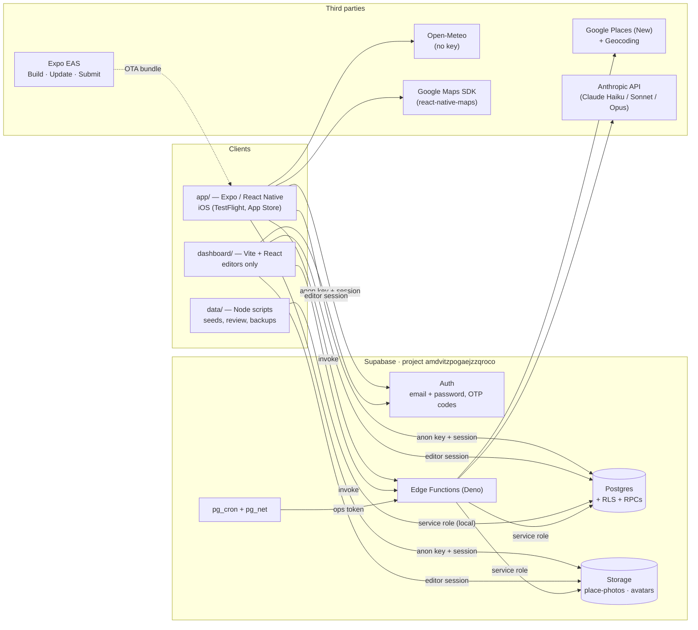
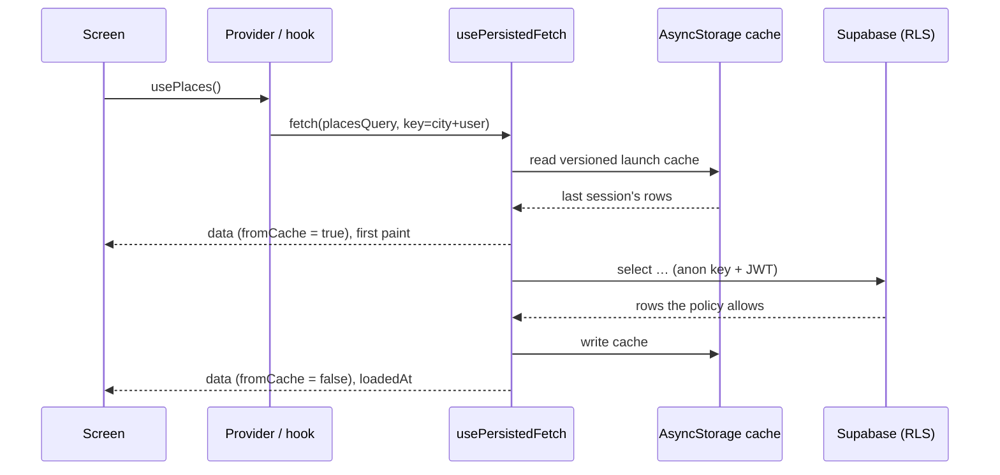
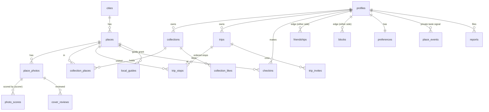
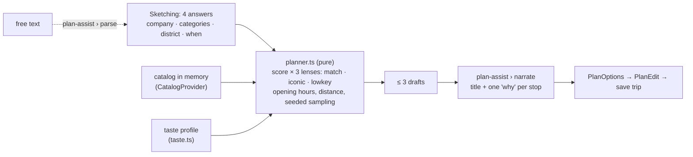
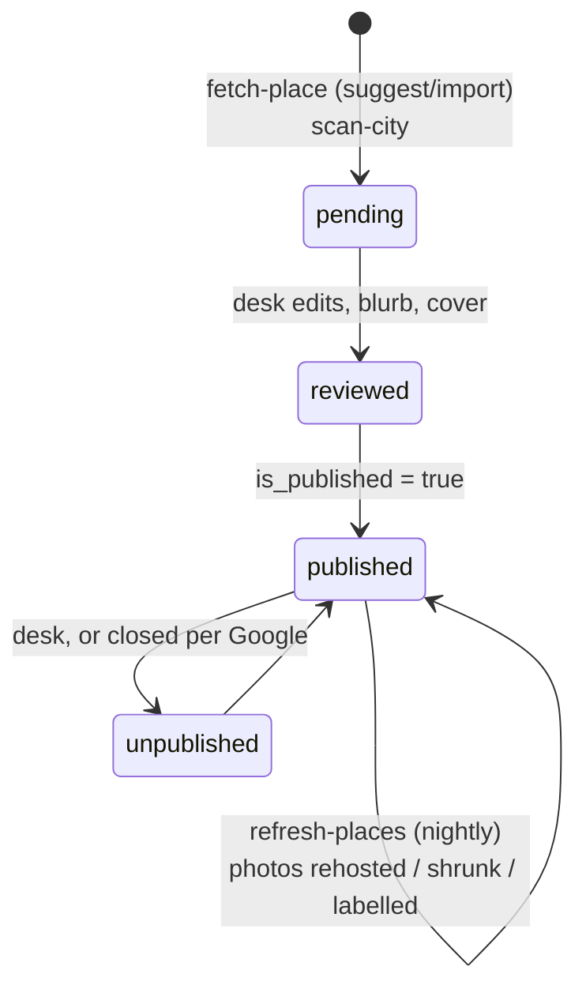
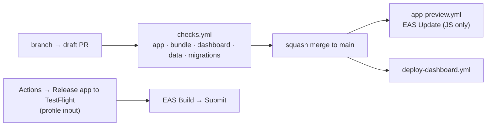

# City Crew — system design

The whole system on one page: what the parts are, what each one owns, and
how a request travels between them. It is a map drawn from the source on
30 Oct 2026. The reasoning behind each decision is in the header comment of
the file that makes it, and this page names those files rather than
repeating them. The rules between the app's layers, and what in CI turns
red when one is broken, are in [`architecture.md`](architecture.md). Read
that page before moving code.

## 1. What the product is

A city guide for Vietnam (Ho Chi Minh City, Hanoi, Da Nang, Da Lat, Huế and
others, each a row in `cities`) in five languages: English, Vietnamese,
Japanese, Simplified and Traditional Chinese. A reader:

- **explores** a curated catalog of places for one city (list and map,
  filters, search in all languages at once);
- **saves** places into collections, and can make them public;
- **plans** a day: four answers (who with, what kind, where, when) become
  up to three drafted itineraries, which can be edited, saved as a trip
  and shared with a crew;
- **checks in**, follows friends, sees what friends saved, and gets
  reminders before a trip.

Behind the reader there is an editorial desk (the dashboard) that curates
the catalog, and a set of server jobs that keep Google data fresh and
photos small.

## 2. Topology

There is **no application server**. The phone app and the desk both talk
directly to Supabase with the public key and the user's own session.
**Postgres Row-Level Security is the authorization layer.** An Edge
Function exists only where a secret is needed: the Google key, the
Anthropic key, or the service role.



| part | where | runtime | deployed by |
|---|---|---|---|
| Mobile app | `app/` | Expo SDK 58, React Native 0.88, React 19, TypeScript | EAS Update on every merge touching `app/` (`app-preview.yml`); binaries by hand (`app-release.yml`) |
| Desk | `dashboard/` | Vite, React, React Router | `deploy-dashboard.yml` on push to `main` |
| Database | `supabase/migrations/` (113 files) | Postgres + RLS | **applied by hand.** CI only tests them |
| Edge Functions | `supabase/functions/` | Deno | deployed by hand |
| Data tooling | `data/` | Node | run locally |

## 3. The mobile app

### 3.1 Layers

```
screens/        one screen per file (23 + explore/, profile/ sub-parts)
   ↓
components/     reusable UI; components/ui/ is the design system
   ↓
lib/*.tsx       providers: shared state in React contexts
   ↓
lib/data/       every question to Postgres / Storage, one file per aggregate
lib/*.ts        pure domain logic: no React, no network, runs in Node
```

Arrows only point down. No screen or component imports Supabase. ESLint's
`no-restricted-imports` enforces this, and per-file coverage floors
(100 % on `lib/*.ts`) keep the pure layer pure. See
[`architecture.md`](architecture.md) for the full table.

### 3.2 Providers: the shared state

`App.tsx` nests providers in dependency order. Each one reads the ones
outside it:

```
ThemeProvider › AppBoundary › Auth › I18n › City › Catalog › Crew
  › Invitations › MyTrips › Checkins › Save › TabBarDuck
```

| provider | owns | notes |
|---|---|---|
| `auth.tsx` | session, profile, sign-in/up/out, delete account | `userId` comes from the device cache within milliseconds, before `session` is confirmed, so per-reader queries do not wait a network round |
| `city.tsx` | the current city | never renders one city and then switches. Order: manual pick › cached location fix (time-capped) › stored auto city › HCMC |
| `i18n.tsx` | UI language, `t()` | fallback order is in `lang.ts`. Traditional Chinese is generated from Simplified (`scripts/hant.ts`) |
| `catalog.tsx` | the city's public places and editorial collections, likes | one copy for the whole app. It used to be fetched by five screens separately |
| `save.tsx` | the reader's private collections, the save sheets' state | the sheets themselves are drawn by `components/SaveSheets.tsx` |
| `crew.tsx`, `invitations.tsx`, `mytrips.tsx`, `checkins.tsx` | friends, trip invites, own trips, check-ins | |
| side-effect syncs | `ReminderSync`, `GuideGrantSync`, `SessionNavSync`, `ThemeAccountSync` | render nothing; keep the OS or the account in step |

Where many readers each read only part of a provider, the context is split
along those lines (`useSession` / `useProfile` / `useAuthActions`,
`useMyLists` / `useSaveActions`, …). A change to one part then does not
re-render readers of another. Render-count tests guard this.

### 3.3 Reads, writes and the cache



- **Reads**: a pure async function in `lib/data/<aggregate>.ts` →
  `lib/data/fetch.ts › usePersistedFetch` (versioned on-device cache,
  stale-while-revalidate, `loaded` / `loadedAt` / `fromCache`) → hook in
  `lib/data/hooks.ts` → provider or screen. `lib/stale.ts` decides when
  to ask again.
- **Writes** go straight to tables under RLS and **throw when refused**,
  so a screen never draws a success that did not happen. Optimistic
  updates are reconciled afterwards (`likes.ts`, and `pendingSaves.ts`,
  which draws a save before the database confirms it). `quota.ts` turns
  a daily-cap refusal into words.
- **Authorization** is never decided in the client. Where the app repeats
  a rule (`guide.ts`, `report.ts`), it does so only to avoid
  offering a control the database would refuse.

### 3.4 Navigation

There are five tabs: **Ideas, Explore, Trips, Collections, Profile**. Each
has its own native stack, and detail screens are registered in several
stacks on purpose. Every screen is wrapped in a `ScreenBoundary`, with
`AppBoundary` as the last resort. Typed routes are in `src/nav.ts`.

### 3.5 Device-side features

| feature | how | file |
|---|---|---|
| Maps | `react-native-maps` with Google provider, clustered pins | `components/PlacesMap.tsx`, `lib/cluster.ts` |
| Location | `expo-location`, used only to pick the nearest city and bias search. Never sent to the weather API | `lib/city.tsx`, `lib/citypick.ts` |
| Weather | Open-Meteo, keyless, queried with the *city's* centre | `lib/weather.ts`, `lib/sky.tsx` |
| Trip reminders | **local** notifications (the evening before and the day of), no push server | `lib/reminders.ts`, `lib/remind.ts` |
| Photo quality | native Expo module `modules/photo-score` (iOS, Apple Vision): aesthetics score and measurements, put into words in `photoScoreVision.ts` | `lib/photoScore*.ts` |
| Data export | JSON file through the share sheet (not a signed URL, for privacy-policy reasons) | `lib/takeout.tsx`, `lib/export.ts` |
| Remote switches | `app_flags` table read at launch, which reaches App Store binaries that OTA cannot | `lib/flags.ts` |
| Themes | 20 palettes, synced to the account | `src/palettes.ts`, `lib/theme.tsx` |

## 4. Core domain

### 4.1 Data model



| group | tables | notes |
|---|---|---|
| Catalog | `cities`, `places`, `place_photos`, `category_terms`, `editorial_collection_origin` | `places` carries names, blurbs and neighbourhoods per language (plus an `i18n` JSON for the newer languages), Google-derived fields (hours, rating, price), `review_status` / `is_published` for the desk's gate |
| Photo judging | `photo_scores` (one row per photo per scorer, e.g. Vision, `claude-labels`), `cover_reviews` | see `docs/photo-labels.md`, `docs/photo-critic.md` |
| People | `profiles`, `preferences`, `friendships`, `blocks`, `reserved_handles`, `local_guides`, `editors` | `profiles` is 1:1 with `auth.users`. Every personal table cascades on account delete |
| Saving | `collections`, `collection_places`, `collection_likes`, `suggestion_dismissals` | collections are private or public. Editorial ones are owned by editorial accounts |
| Planning | `trips`, `trip_stops`, `trip_invites` | a trip has a city, day, part of day, company and categories |
| Activity | `checkins`, `place_events` | `place_events` feeds only the taste profile |
| Safety | `reports`, `moderation_log` | daily caps and the ban on self-reports are enforced in policy |
| Ops | `app_flags`, `ops_tokens`, `startup_traces`, `deck_traces` | traces are written only by diagnostic channels (§7) |

RPCs (`security definer` functions) cover what a plain policy cannot:
counts across other people's rows (`collection_like_counts`,
`trip_crew_counts`, `mutual_saves_counts`), social graph queries
(`friend_suggestions`, `suggested_friends`, `block_user`), moderation
(`moderate_collection`, `moderate_profile`, `reports_queue`), quotas
(`own_place_photos_today`, `my_reports_today`) and guide powers
(`guide_set_cover`, `guide_set_hidden`). Policies call `auth.uid()` and
`is_editor()` once per query, written as `(select …)`. A test in
`supabase/tests/` enforces this.

### 4.2 The planner



Choosing places is **arithmetic on the phone**, so a reader with no
signal still gets a plan. `planner.ts` scores the catalog under three
weightings. It honours opening hours on the city's clock (`clock.ts`,
`format.ts › openState`), orders stops by distance (`travel.ts`, `geo.ts`)
and samples among near-equals using an explicit `seed`, so that Regenerate
means something and the function stays pure. `gaps.ts` returns fewer
drafts when the catalog cannot honestly support three. Only the *wording*
comes from a model: `plan-assist` uses Claude Haiku to name the plan and
give a reason per stop, and can parse a typed request into the four
answers.

### 4.3 Search, taste and ranking

- `search.ts` and `searchIndex.tsx` search one haystack across all
  languages, with diacritics folded ("banh mi" finds "Bánh mì") and desk
  synonyms from `category_terms`.
- `taste.ts` and `tasteProfile.tsx` turn four signals (preferences, saved
  collections, own suggestions, `place_events`) into a bounded affinity.
  The planner reads it through the `Taste` interface.
- `rank.ts`, `popular.ts` and `exploreView.ts` order Explore.

## 5. Server side

### 5.1 Edge Functions

| function | caller | gate | what it does |
|---|---|---|---|
| `fetch-place` | app (add / suggest a place), desk | signed in. `import` is for editors only | Google Places search, reverse geocode, import as a pending, unpublished place. Daily allowance (`fetch_place_allowance`) |
| `plan-assist` | app | signed in | Claude Haiku: `narrate` a draft, `parse` free text |
| `delete-account` | app | account owner | deletes the auth user, and the cascades remove the rest. Catalog contributions are set to null, not deleted |
| `scan-city` | desk | editor | one curated Places query per category, imported as pending |
| `suspend-user` | desk | editor | auth-level ban (needs the service role) |
| `write-blurb` | desk | editor | Claude Haiku drafts blurbs per language and **writes nothing**: the desk's Save is the gate |
| `label-photos`, `rate-photos` | desk, ops token | editor / token | Claude vision: photo type and cover criteria, beauty within kind. `label-photos` writes to `photo_scores` as `claude-labels` |
| `refresh-places` | `pg_cron` nightly | ops token | re-asks Google about the stalest places (`_shared/refresh-place.ts`) |
| `shrink-photos` | `pg_cron` hourly | ops token | resizes Storage photos to what the app draws |
| `rehost-photos`, `refresh-photos`, `prune-photos` | run by hand | editor / token | copy Google photos into Storage, replace retired `photo_ref`s, delete orphan files |

`_shared/` holds the logic several functions need (`import-place.ts`,
`rehost.ts`, `classify.ts`, `gate.ts`, `place-name.ts`, …). Its tests run
from `app/src/lib/*.fn.test.ts`, under the Edge Function coverage floor.

### 5.2 Scheduled work

`pg_cron` + `pg_net` call functions with a token from `ops_tokens`. The
schedules live in `supabase/functions/<job>/cron.sql` and are **applied by
hand**, not as migrations: they mint a secret, and the migration test
database has no `pg_cron`.

### 5.3 The place lifecycle



A place that a reader suggests is visible only to that reader and the desk
until an editor publishes it. `isLive` (`lib/live.ts`) is the single
definition of "show this to readers".

## 6. The desk (`dashboard/`)

It uses the same model as the app. `api.js` talks to Supabase with an
editor's session, and RLS (`is_editor()`) decides what may be written.
Routes are in `dashboard/src/routes.jsx`:

- **Places**: list, editor (fields, blurbs per language, photos, cover),
  add, scan a city.
- **City**: city hero and copy. **Search words**: synonyms.
- **Reports**: moderation queue → unpublish, clear a field, suspend.
- **Covers / photo rounds**: cover review and the measuring rounds for
  photo labels and ratings.
- **Analytics**: contributors, coverage per category.

`data/` holds the offline side: seed JSON, `places.review.json`, backup and
snapshot scripts, and the frozen bootstrap pipelines (`fetch-places.mjs`,
`upsert-supabase.mjs`). These are kept for provenance and are no longer
how places arrive.

## 7. Release channels and diagnostics



The build profile stamps a channel into each binary (`eas.json`), and
`lib/channel.ts` reads it back:

| channel | diagnostics |
|---|---|
| `development` | on, but timings are skewed by `__DEV__` |
| `preview` | **on**: `startup_traces` (launch waterfall, `trace.ts`) and `deck_traces` (`decktrace.ts`) |
| `production` | **off**. `lib/legal.ts` promises the App Store build sends nothing, and a test enforces it |

How to measure on a device is in [`tracing.md`](tracing.md).

## 8. Quality gates

| gate | where |
|---|---|
| typecheck, lint (zero warnings), vitest, the same suite on a DST clock, coverage floors per file | `app` job |
| `expo export` bundles | `bundle` job |
| desk lint + tests | `dashboard` job |
| taxonomy in sync across app, desk and check constraint, plus data tests | `data` job |
| every migration from scratch on a throwaway Postgres, plus RLS tests (run twice, the second time on rewritten policies) | `migrations` job (`supabase/tests/run.sh`) |
| iOS simulator end-to-end (Maestro) | local only. See [`testing/e2e-simulator.md`](testing/e2e-simulator.md) |

## 9. Cross-cutting decisions

| decision | why | where it is argued |
|---|---|---|
| No app server | RLS plus a few secret-holding functions cover everything a server would do, without another thing to deploy, pay for or break | `architecture.md` |
| No Redux / TanStack Query | context plus `usePersistedFetch` covers this amount of shared state | `architecture.md` |
| Plan on the device, narrate on the server | works offline, costs no model call to choose, keeps the choice testable | `planner.ts`, `plan-assist/index.ts` |
| Photos rehosted and shrunk in own Storage | Google `photo_ref`s expire, and egress and storage limits on the plan | `rehost-photos`, `shrink-photos`, `refresh-photos` headers |
| Google data cached longer than the Maps ToS allows | open item C1 | `tech-eval-app-store.md` |
| Model output never written straight to reader-facing text | an editor's Save is the gate for every sentence the app shows | `write-blurb/index.ts` |
| Local notifications, not push | the trip date is known when the trip is saved, so no push server or token is needed | `lib/reminders.ts` |
| Keyless weather | a key in a bundle can be read by anyone | `lib/weather.ts` |
| Account delete by cascade | App Store 5.1.1(v), and every personal table was built for it | `delete-account/index.ts` |

## 10. Known rough edges

These are listed in [`architecture.md`](architecture.md) § "Chỗ kiến trúc
chưa sạch". The main one is large screen files: `PlaceDetailScreen`,
`CollectionsScreen` and `CollectionDetailScreen` are each around 1,700 to
1,800 lines. The coverage floors keep them correct, but not easy to read.
Also open: the Google Places cache (C1) and the photo-critic steps in
[`photo-critic.md`](photo-critic.md).
